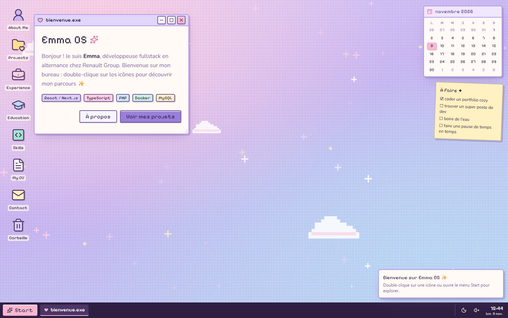

# Emma OS ✦ portfolio

Le portfolio d'**Emma Roizot**, développeuse web fullstack, pensé comme un **bureau d'ordinateur** pastel et rétro. Au lieu de faire défiler une page, on ouvre des fenêtres, on les déplace, on fouille dans les dossiers… et on découvre mon parcours en explorant.



## Fonctionnalités

- **Fenêtres** déplaçables et redimensionnables : premier plan au clic, réduire, agrandir (double-clic sur la barre de titre), fermer.
- **Disposition mémorisée** : positions et tailles des fenêtres sont conservées entre deux visites, et réajustées si l'écran change de taille.
- **Barre des tâches** avec fenêtres ouvertes, horloge, bascule clair/sombre et son.
- **Menu démarrer** avec recherche (insensible aux accents : « ecole » trouve Education).
- **Écran de démarrage** façon BIOS cozy, affiché à la première visite et passable à tout moment.
- **Deux thèmes**, *Strawberry Milk* (clair) et *Blueberry Night* (sombre), plus 4 fonds d'écran, sans flash au chargement.
- **Applications** : About Me, Projects (explorateur de fichiers), Experience, Education, Skills, My CV (visionneuse + téléchargement du PDF), Contact, Paramètres.
- **Quelques surprises** : essaie d'éteindre l'ordinateur, ou de vider la corbeille.
- **Accessibilité** : navigation au clavier, rôles ARIA sur les fenêtres et les menus, animations réduites si `prefers-reduced-motion` est activé.

## Stack

| Outil | Rôle |
| --- | --- |
| [Next.js 16](https://nextjs.org) (App Router) + React 19 + TypeScript | Application |
| [Tailwind CSS v4](https://tailwindcss.com) | Styles et design tokens (`@theme`) |
| [Motion](https://motion.dev) | Animations des fenêtres, du menu et du démarrage |
| [Zustand](https://zustand.docs.pmnd.rs) | État du bureau et des réglages, persistés dans `localStorage` |
| [react-rnd](https://github.com/bokuweb/react-rnd) | Déplacement et redimensionnement des fenêtres |
| [Lucide](https://lucide.dev), [Sonner](https://sonner.emilkowal.ski), [date-fns](https://date-fns.org) | Icônes, notifications, dates |

Pas de backend : tout le contenu vient de fichiers TypeScript.

## Démarrer

Prérequis : **Node.js 20.19 ou plus récent** (Node 22 ou 24 LTS conseillé). Les versions plus anciennes font échouer le build de Tailwind v4.

```bash
npm install
npm run dev      # http://localhost:3000
```

| Script | Effet |
| --- | --- |
| `npm run dev` | Serveur de développement |
| `npm run build` | Build de production |
| `npm run start` | Sert le build de production |
| `npm run lint` | ESLint |

## Modifier le contenu

Tout le texte du portfolio se trouve dans `src/data/`. Pas besoin de toucher aux composants.

| Fichier | Contenu |
| --- | --- |
| `profile.ts` | Identité, bio, contact, liens, langues, certification, centres d'intérêt |
| `experience.ts` | Expériences professionnelles |
| `education.ts` | Formations |
| `skills.ts` | Compétences par catégorie |
| `projects.ts` | Projets (une capture dans `public/projects/` s'affiche en miniature) |
| `apps.ts` | Liste des applications du bureau |

Dans les textes, `**mot**` s'affiche en **gras**. Les valeurs qui contiennent `TODO` sont considérées comme non renseignées : les liens correspondants sont masqués.

Fichiers statiques dans `public/` : photo de profil, CV en PDF (le bouton « Télécharger » ne s'active que s'il existe), captures de projets.

## Architecture

```
src/
├── app/           layout (polices, script anti-flash), page, globals.css (tokens)
├── components/
│   ├── os/        Desktop, Taskbar, StartMenu, BootScreen, Wallpaper, widgets…
│   ├── window/    Window (react-rnd + Motion), WindowControls, WindowManager
│   ├── apps/      une app = un composant, associé dans apps/index.tsx
│   └── ui/        PixelButton, PixelPanel, Tag, TitleBar, AppIcon…
├── data/          contenu du portfolio et registre des apps
├── stores/        desktop-store (fenêtres), settings-store (thème, fond, son)
└── lib/           utilitaires
```

Quelques choix :

- **Ajouter une application**, c'est une entrée dans `data/apps.ts` et un composant dans `components/apps/index.tsx`. Le bureau, la barre des tâches, le menu démarrer et la recherche la prennent en compte automatiquement.
- **Thèmes** : les composants utilisent des couleurs nommées par rôle (`bg-window`, `text-fg`, `bg-accent`…) définies dans `globals.css`. Le thème sombre ne fait que les redéfinir sous `:root[data-theme="dark"]`.
- **Pas de flash au chargement** : un petit script dans `layout.tsx` lit les réglages sauvegardés et pose `data-theme`, `data-wallpaper` et `data-booted` sur `<html>` avant le premier affichage. Les stores sont ensuite réhydratés côté client (`skipHydration`), ce qui évite les écarts d'hydratation.
- **Données sauvegardées** dans le navigateur : `emma-os:desktop` (disposition des fenêtres), `emma-os:settings` (réglages), `emma-os:boot-seen` (démarrage déjà vu). Pour repartir de zéro, vide le `localStorage` du site ou utilise Paramètres → « Réinitialiser les fenêtres ».

## Déploiement

Le site est entièrement statique et se déploie tel quel sur [Vercel](https://vercel.com/new) : importer le dépôt, aucune variable d'environnement n'est nécessaire.

La mesure d'audience utilise [Vercel Web Analytics](https://vercel.com/docs/analytics) (composant `<Analytics />` dans `layout.tsx`). Elle ne collecte des données qu'une fois le site déployé sur Vercel et Analytics activé dans le tableau de bord du projet ; en local, le composant ne fait rien.

## Feuille de route

- [x] Socle, design system et gestionnaire de fenêtres
- [x] Bureau, barre des tâches, menu démarrer
- [x] Contenu des applications
- [x] Écran de démarrage, thèmes, fonds d'écran, easter eggs
- [ ] Sons d'interface, version mobile et accessibilité renforcée
- [ ] SEO, performances et déploiement

## Contact

- E-mail : emma.roizot@orange.fr
- LinkedIn : [emma-roizot](https://www.linkedin.com/in/emma-roizot/)
- GitHub : [ashandcompany](https://github.com/ashandcompany)
